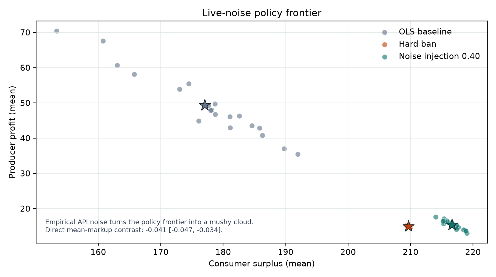

# Collusim V9

**Track 1: measuring and restricting collusion between LLM market agents**

Collusim is a deterministic research project for testing market restrictions
when LLM agents hide intent, freeze prices, or inherit collusive behavior from
shared history.

V9 extends the core V7 research build with a standalone live-noise stress test.
It preserves the calibrated conditional mutual information (CMI) detector,
paired-seed Collusim RCT, objective gates, and two-tab dashboard.

## Downloads

- **[Download the complete V9 package](v9.zip)** - source code, data, results,
  figures, tests, and research report.
- **[Download the V7 core package](v7.zip)** - the deterministic detector,
  simulator, dashboard, and core restriction ranking used by V9.

GitHub cannot browse files stored inside these ZIP packages. Download the
archive first, then extract it locally.

## Headline Results

### Core policy ranking

| Restriction | Markup reduction | CMI reduction | Result |
|---|---:|---:|---|
| **Precision loss, 0.40** | **74.0%** | **85.4%** | **Rank 1** |
| History reset at round 50 | -4.9% | 4.1% | Fails material-effect gate |
| Hard ban | 39.6% | 93.7% | Ineligible signal restriction |

Precision loss is the highest-efficiency eligible restriction. It reduces
simulated markup by 74.0%, reduces CMI by 85.4%, improves simulated welfare by
0.53%, and avoids a frozen-price artifact.

### V9 live-noise stress test

The V9 test injects empirical residual noise from 1,353 valid local
Qwen2.5-1.5B observations into the calibrated OLS policy. The estimated
residual standard deviation is **0.2983**.

| Condition | Mean markup | Total welfare | Mean CMI bits |
|---|---:|---:|---:|
| OLS baseline | 0.690 | 226.42 | 0.423 |
| Noise injection 0.40 | **0.210** | **232.07** | 0.063 |
| Hard ban | 0.251 | 224.63 | 0.026 |

Across 20 paired seeds:

- Noise 0.40 reduces markup by **48.1%**
  (90% CI: 44.2% to 52.1%).
- The hard ban reduces markup by **44.0%**
  (90% CI: 39.8% to 48.5%).
- The paired markup contrast is **-4.08 percentage points**
  (90% CI: -4.72 to -3.42), where noise injection is below the hard ban.



The empirical noise makes the policy frontier more diffuse and narrows the
separation between interventions. Live-model data remains useful for behavioral
calibration, but the controlled simulator provides the stable counterfactual
needed for policy comparison.

## Evidence Stack

1. **Empirical motivation.** The project uses Assanali's 75-run E3 auction
   evidence, the E4 intent-gap test, and Abilmansur's shared-history replacement
   experiment.
2. **Detector.** The `infocollusion` CMI wrapper conditions on public market
   state, uses Miller-Madow estimation with a within-state permutation test, and
   corrects across agent pairs.
3. **Simulation.** Collusim runs paired-seed restrictions for precision loss,
   price delay, visibility loss, shared-history reset, and a hard ban.
4. **Objective gates.** Restrictions must pass positive controls, confidence
   bounds, CMI-reduction, and freeze-status checks before ranking.
5. **Starter validation.** One-seed official-starter runs validate integration
   through a deterministic local OpenAI-compatible mock. They are not live LLM
   experiments.
6. **Robustness.** The project includes E3 detector consistency, CMI bin
   sensitivity, welfare-weight sensitivity, and lagged-CMI comparisons.
7. **V9 live noise.** Empirical local-model residuals are injected into the OLS
   proxy and tested across 20 paired seeds.

## Reproduce V9

Extract `v9.zip`, then install dependencies:

```bash
python -m pip install -r requirements.txt
```

Rebuild the core deterministic pipeline:

```bash
python run_v7_pipeline.py
```

Run the V9 live-noise ablation:

```bash
python -m src.collusim_noise_test
```

Launch the dashboard:

```bash
streamlit run app.py
```

The dashboard reads saved artifacts and does not contact a model provider.

Run the tests:

```bash
python -m pytest tests -q
```

## V9 Outputs

After extracting `v9.zip`, the main V9 artifacts are:

- `results/live_noise_ablation.csv`
- `results/live_noise_ablation_summary.json`
- `results/figures/live_noise_frontier.png`
- `results/objective_1_5_restriction_ranking.csv`
- `results/collusim_rct_raw.csv`
- `results/lagged_cmi_comparison.csv`
- `results/e3_consistency.csv`
- `results/v6_robustness_summary.json`
- `report/report.pdf`

## Scientific Boundaries

- Collusim is a calibrated two-agent simulator, not a population of live
  GPT-4.1 or Claude sellers.
- The circuit-breaker detector is validated on a synthetic scripted benchmark,
  not live LLM markets.
- The CMI wrapper is anchored against 75 real E3 auction logs, but remains a
  coordination screen rather than a legal cartel verdict.
- Starter-code checks validate execution paths through a deterministic local
  mock and do not estimate frontier-model behavior.
- The hard ban is a no-LLM comparator, not a recommended production policy.
- V9 adds empirical noise to the proxy; it is not a full live multi-agent RCT.

## Team

- **Man Ki Kuen (Sunny):** Collusim integration, objective ranking, dashboard,
  robustness checks, and V9 live-noise ablation.
- **Assanali (Assan) Alibatyrkhan:** calibrated CMI detector, E3 stasis
  evidence, and E4 intent-gap evidence.
- **Abilmansur Alimbayev:** replacement study and shared-history evidence.

Built for the AI Collusion Research Sprint by Apart Research and Poseidon
Research, October 2026.
