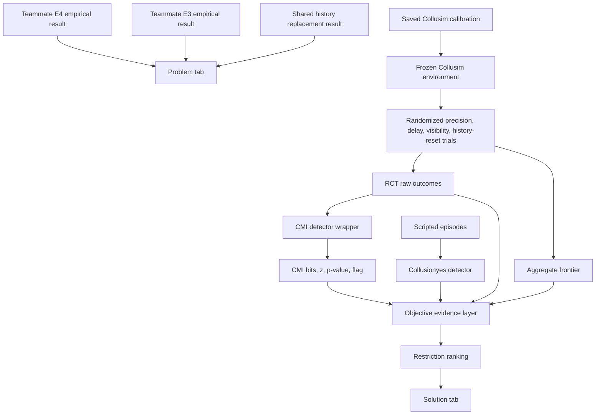

# V5 Architecture

## 1. Purpose

V5 presents two linked layers:

1. **The problem:** fixed empirical findings from E3, E4, and Teammate 2's
   shared-history replacement study.
2. **The solution:** a deterministic Collusim simulation that tests market
   restrictions when real LLM colluders freeze prices or hide their intent.

V5 does not run RiskLab, Ollama, local probes, or model-provider calls.

## 2. Invariants

- `src/detection/cmi_wrapper.py` is the detector and is not changed by V5.
- `src/collusim/agents.py` remains unchanged.
- `src/collusim/environment.py` adds the history-reset intervention while
  preserving the existing agent policy.
- `src/collusim/experiments.py` adds `history_reset` to the existing RCT grid.
- `src/collusim/objectives.py` applies the existing gates to the new lever.
- The randomized Collusim RCT and objective ranking remain the source of the
  solution-side evidence.
- Empirical Tab 1 content is stored in `app.py`; V5 does not regenerate it.
- The dashboard uses saved artifacts and requires no model server.

## 3. High-Level Architecture



The arrows into Tab 1 are static evidence. The arrows into Tab 2 are rebuilt
only from deterministic local computation.

## 4. Runtime Components

| Component | File | Responsibility |
|---|---|---|
| Dashboard | `app.py` | Two-tab presentation and fixed empirical findings |
| Pipeline | `run_v5_pipeline.py` | Rebuild detector, RCT, and objective artifacts |
| Configuration | `config.py` | Seeds, market settings, ablation grids, feature names |
| Calibration | `src/llm_track/estimate.py` | OLS proxy calibration and residuals |
| Agents | `src/collusim/agents.py` | Calibrated proxy and hard-ban comparator |
| Environment | `src/collusim/environment.py` | Repeated pricing market |
| Experiments | `src/collusim/experiments.py` | Paired-seed RCT, welfare, CMI columns |
| CMI wrapper | `src/detection/cmi_wrapper.py` | Continuous prices to discrete detector input |
| CMI implementation | `src/external/infocollusion/` | Conditional MI and permutation tests |
| Scripted benchmark | `src/core_sim.py` | Labeled episodes and circuit-breaker features |
| Objective analysis | `src/collusim/objectives.py` | Controls, gates, ranking, summary |

## 5. Dashboard

### Tab 1: The Problem

The tab contains three hard-coded evidence cards:

- **Teammate E4, Intent vs. Action:** 12 Qwen2.5-7B games produced no
  behavioral difference after agents were instructed to collude.
- **Teammate E3, Cartel Stasis:** 75 real GPT-4.1/Claude auctions showed an
  87% hold rate, making action-based detection blind.
- **Teammate 2, Shared History Trap:** a replacement inherits the
  cartel from its visible history (`G50 = 0.80` versus `0.32` for fresh pairs).

The subtitle states why Collusim exists: to test restrictions when real-world
colluders freeze prices and hide intent.

No local model metrics, validation status, or fallback message is rendered.

### Tab 2: The Solution

The tab displays:

- the 74% noise-injection result;
- the restriction frontier using welfare and collusion reduction;
- the price-versus-CMI evidence chart;
- the ranked restrictions;
- positive controls and raw RCT data in expanders.

The winner is read from `results/objective_1_5_restriction_ranking.csv`.

## 6. Collusim Data Flow

The calibration file supplies the linear pricing policy and empirical residual
draws. Collusim randomizes four signal conditions over paired seeds:

| Lever | Meaning |
|---|---|
| `precision` | Noise added to the observed rival signal |
| `delay` | Age of the rival signal |
| `visibility_loss` | Probability that the rival signal is absent |
| `history_reset` | Clear visible history once at round 50 and inject one `1.473` competitive warm-up round |

Each seed records:

- prices and demand;
- markup and total welfare;
- blind-agent share;
- CMI bits and permutation z-score;
- CMI p-value and flag;
- action entropy and freeze status.

The same seed is reused for baseline and treatment, allowing paired
confidence intervals.

## 7. CMI Detector Flow

The retained detector receives a `(rounds, agents)` price matrix.

Actions:

```text
down = price change < -0.01
hold = price change within +/-0.01
up   = price change > 0.01
```

Conditioning state:

```text
previous-round mean public price,
binned at 1.10, 1.25, 1.50, 1.75,
2.00, 2.25, 2.50, 2.75
```

Detector steps:

1. Discretize each agent's price movement.
2. Encode the previous public mean-price bin.
3. Estimate Miller-Madow corrected CMI for every pair.
4. Build a within-state permutation null.
5. Correct p-values with Bonferroni over pairs.
6. Record CMI bits, permutation z, p-value, flag, and top pair.

CMI measures dependence outside the declared public state. It is not a
stand-alone legal or intentional collusion classifier.

## 8. Objective Evidence Layer

`src/collusim/objectives.py` produces two controls:

| Control | Treated | Untreated |
|---|---|---|
| RCT behavioral control | Calibrated proxy | Hard-ban human agent |
| Scripted detector control | Colluding episodes | Competitive episodes |

The lower 90% confidence bound must exceed `0.05` for markup and `0.02` bits
for CMI.

For objective 1.1, every ablation reports price, CMI, detector status, action
entropy, and the conditioning state.

For objective 1.5, a non-ban restriction is eligible only when:

- both controls pass;
- markup and CMI reductions have positive lower confidence bounds;
- CMI reduction is at least 10%;
- CMI reduction is at least 0.02 bits;
- fewer than half of episodes are frozen;
- the hard ban is excluded.

Eligible restrictions are ranked by:

```text
markup reduction / absolute welfare movement
```

## 9. Output Contracts

| Artifact | Purpose |
|---|---|
| `results/collusim_rct_raw.csv` | Seed-level RCT evidence |
| `results/collusim_frontier.csv` | Aggregate restriction frontier |
| `results/episodes.csv` | Labeled scripted detector data |
| `results/detector_metrics.json` | Detector metrics and selected features |
| `results/objective_1_1_positive_control.csv` | RCT and scripted controls |
| `results/objective_1_1_variable_ablations.csv` | Full ablation evidence |
| `results/objective_1_5_restriction_ranking.csv` | Full candidate ranking |
| `results/restriction_ranking.csv` | Direct handoff copy of the ranking |
| `results/v5_objective_summary.json` | Machine-readable summary |

## 10. Reproducibility

Install and rebuild:

```bash
python -m pip install -r requirements.txt
python run_v5_pipeline.py
```

Run the dashboard:

```bash
streamlit run app.py
```

Run tests:

```bash
python -m pytest tests -q
```

No pipeline stage contacts a model provider.

## 11. Current Result

Noise injection at precision-loss strength `0.40` is the selected restriction:

- markup reduction: `74.0%`;
- CMI reduction: `85.4%`;
- welfare effect: `0.53%` improvement;
- efficiency ratio: `0.248`;
- 90% efficiency interval: `[0.248, 0.673]`.

The one-time history reset does not beat continuous noise injection. With the
requested `1.473` warm-up, it increases markup by `4.9%` and reduces CMI by
`4.1%`, so it fails the material-effect gate and ranks last among non-ban
candidates.

## 12. Limitations

- Collusim is a calibrated deterministic proxy, not a live LLM market.
- CMI can be blind to coordination expressed only through the conditioning
  state.
- Frozen prices remove action variation and make CMI uninformative.
- The hard ban is a no-LLM control, not a same-model no-communication twin.
- Action discretization and state-bin choices remain researcher decisions.
- Tab 1 empirical results are fixed evidence from the teammate's experiments,
  not outputs of this repository.
